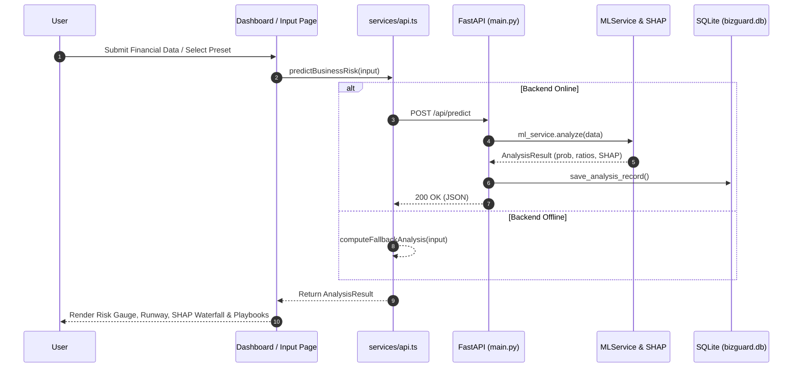

# ARCHITECTURE.md — StartGuard AI System Architecture

## 1. System Overview

StartGuard AI is built as a decoupled, resilient client-server architecture consisting of a modern React 19 single-page application and a high-performance Python FastAPI microservice backed by an XGBoost machine learning engine and SQLite storage.

```
┌─────────────────────────────────────────────────────────────┐
│                 Client Browser (Vite / React 19)            │
│  - State Management: App.tsx (SPA Router + Shared State)    │
│  - UI: Vanilla CSS Design System with CSS Custom Variables  │
│  - Offline Fallback Engine in services/api.ts                │
└──────────────────────────────┬──────────────────────────────┘
                               │ HTTP / JSON (Port 5173 -> 8000 Proxy)
                               ▼
┌─────────────────────────────────────────────────────────────┐
│                  FastAPI Backend Service                     │
│  - CORS Middleware enabled for cross-origin requests        │
│  - Pydantic v2 Request/Response validation                  │
│  - SQLite Database (`backend/database/bizguard.db`)          │
└──────────────┬───────────────────────────────┬──────────────┘
               │                               │
               ▼                               ▼
┌──────────────────────────────┐ ┌────────────────────────────┐
│      MLService & Pipeline     │ │   Recommendation Engine    │
│  - XGBoost GBDT Model        │ │  - Rules-based playbooks   │
│  - SHAP TreeExplainer        │ │  - Runway compression      │
│  - Financial Feature Eng.    │ │  - Unit economics advisor  │
└──────────────────────────────┘ └────────────────────────────┘
```

---

## 2. Frontend Architecture

- **SPA Routing**: Routing is entirely state-driven within `frontend/src/App.tsx`. The `activePage` state holds one of:
  `'landing' | 'login' | 'signup' | 'dashboard' | 'input' | 'ledger' | 'prediction' | 'shap' | 'recommendations' | 'reports' | 'diagnostics'`.
- **Theme System**:
  - Managed in `App.tsx` and toggled via `Navbar.tsx`.
  - Dark mode is default.
  - Light mode activates by setting `className="theme-light"` on `document.body` or `data-theme="light"`, overriding all CSS custom properties in `style.css`.
  - State persisted in `localStorage.getItem('sg_theme')`.
- **Resilience / Fallback Layer**:
  - `services/api.ts` implements a transparent dual-mode pattern:
    1. Attempts to communicate with FastAPI at `/api/*` (proxied by Vite to `http://127.0.0.1:8000`).
    2. If the backend is unreachable or errors, `computeFallbackAnalysis()` and `computeFallbackSimulation()` run locally in TypeScript using deterministic financial models.
- **Component Architecture**:
  - Pure React component tree with props-down, events-up data flow.
  - No heavyweight external state library (Redux/Zustand); lightweight React hooks (`useState`, `useEffect`, `useMemo`).
  - No heavyweight chart library; SVG-based procedural visualizations (`RiskGauge.tsx`, `SHAPWaterfallChart.tsx`, `CashGapForecastRadar.tsx`).

---

## 3. Backend Architecture

- **Server Framework**: FastAPI (`backend/main.py`) serving asynchronous endpoints.
- **Data Validation**: Strict Pydantic models in `backend/schemas/business.py`.
- **Service Layer**:
  - `MLService` (`backend/services/ml_service.py`):
    - Loads pre-trained `.joblib` model weights and pre-fitted SHAP explainer on initialization.
    - Performs feature engineering (`_engineer_row()`) calculating derived ratios: Altman Z-score, Current Ratio, Debt-to-Equity, Cash-to-Debt coverage, and ARR per employee.
    - Generates SHAP values for top risk drivers and mitigating factors.
  - `recommendation_engine.py`:
    - Synthesizes quantitative findings into prioritized actionable turnaround playbooks (`HIGH`, `MEDIUM`, `STRATEGIC`).

---

## 4. Database Architecture

- **Engine**: SQLite via SQLAlchemy 2.0 ORM (`backend/database/db.py`).
- **File Location**: `backend/database/bizguard.db`.
- **Threading**: Configured with `connect_args={"check_same_thread": False}` for multi-worker ASGI compatibility.
- **Storage Strategy**: Hybrid relational + document store. Core query fields (`company_name`, `failure_probability`, `risk_level`, `health_score`) are indexed SQL columns, while the full comprehensive payload is stored as serialized JSON (`payload_json: Text`) to preserve full analysis snapshots without complex schema migrations.

---

## 5. API Communication & Proxy

- During development, Vite runs on `http://localhost:5173`.
- `vite.config.ts` proxies all requests starting with `/api` to `http://127.0.0.1:8000`.
- CORS middleware in FastAPI allows all origins (`allow_origins=["*"]`) for direct access when needed.

---

## 6. How Major Modules Communicate


