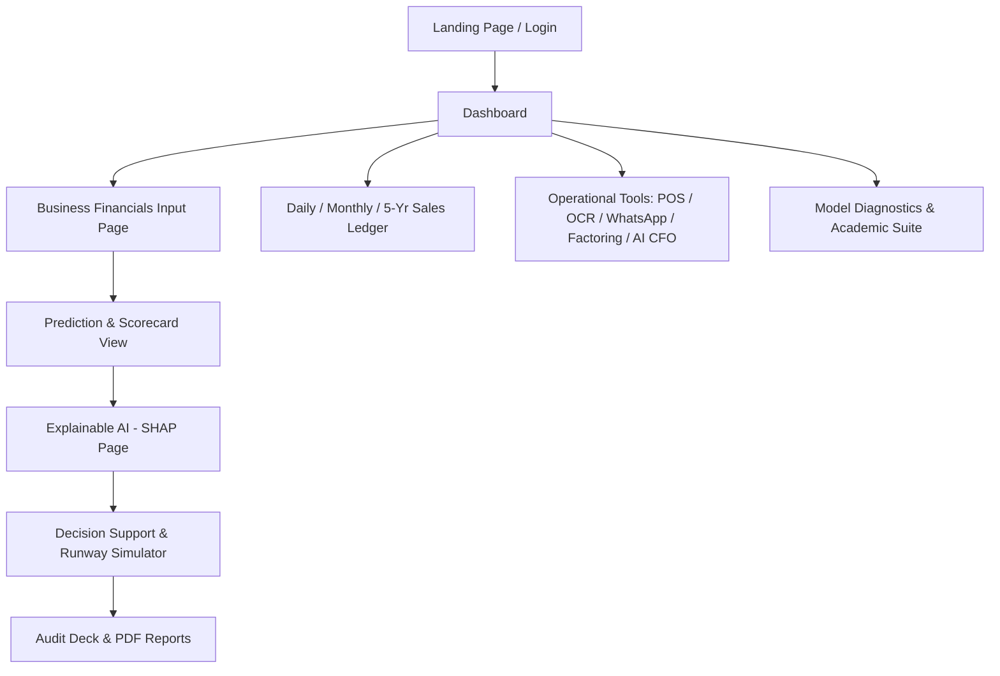

# PROJECT_CONTEXT.md — StartGuard AI Application Context & Map

## 1. What the Application Does
StartGuard AI is a predictive intelligence and preventive decision support system designed to save startups, retail businesses, supermarkets, and cafes from insolvency. It evaluates financial fundamentals (burn velocity, treasury runway, working capital, gross margin, unit economics) through an XGBoost / Gradient Boosted Trees model and produces:
- A failure probability percentage (0–100%) and risk classification (`LOW RISK`, `MODERATE RISK`, `HIGH RISK`).
- Liquid Cash Runway calculations (months remaining before cash reaches zero).
- Explainable AI (XAI) feature importance breakdowns via SHAP waterfall diagrams showing exact risk drivers vs defensive moats.
- Preventive decision playbooks with interactive sliders (burn reduction, growth boost, bridge financing).
- Operational utilities: End-of-Day POS Settlement, Invoice OCR Scanner, Cash Gap Radar, Deadstock Clearance, Multi-Store Branch Performance Matrix, and an AI CFO Copilot Drawer.

---

## 2. Main User Types & Roles
1. **Startup Founder / CEO**: Analyzes runway burn rate, models bridge equity rounds, and simulates OPEX cuts.
2. **Shopkeeper / Supermarket Manager**: Performs daily cash reconciliation at closing, monitors 7-day supplier payment cliffs, and tracks deadstock turnover.
3. **Angel Investor / Venture Analyst**: Reviews solvency health scorecards, LTV:CAC ratios, and exports investor-ready PDF audit decks.
4. **Academic Examiner / Evaluator**: Inspects model diagnostics, confusion matrices, ROC-AUC curves, and mathematical SHAP proofs.

---

## 3. Main Application Flows



1. **Preset / Custom Company Selection**: Users choose from 5 built-in sector presets (`Tech Startup`, `Supermarket`, `Retail Shop`, `Cafe & Restaurant`, `Manufacturing SME`) or add their own company via `CreateCompanyModal`.
2. **Analysis Flow**: `App.tsx` calls `predictBusinessRisk(input)` via `services/api.ts` $\to$ Python FastAPI `/api/predict` (or local fallback) $\to$ results stored in state and SQLite $\to$ UI updates all metric cards.
3. **Simulation Flow**: User navigates to Recommendations $\to$ moves scenario sliders $\to$ calls `/api/simulate` $\to$ visualizes runway expansion in real time.
4. **Ledger & POS Flow**: Cash flow ledger provides Excel-like entry for daily cash, credit, footfall, and expenses; POS modal supports voice dictation.

---

## 4. Main Pages / Screens (`frontend/src/pages/`)

| Page Component | Path / Route Key | Purpose |
|---|---|---|
| **LandingPage.tsx** | `activePage === 'landing'` | High-impact product showcase, quick-start company presets, feature value propositions. |
| **Login.tsx** | `activePage === 'login'` | Authentication screen with 1-click preset login buttons (`demo123`). |
| **Signup.tsx** | `activePage === 'signup'` | User onboarding and account creation simulation. |
| **Dashboard.tsx** | `activePage === 'dashboard'` | Main command center: 5-sector selector, 4 core KPI cards, risk gauge, quick action buttons, Cash Gap Radar, Supplier Dues, Deadstock Card, Ratio Scorecard, and SHAP summary. |
| **BusinessInput.tsx** | `activePage === 'input'` | Comprehensive financial form with 18+ inputs (ARR, burn, cash, debt, CAC, LTV, working capital, inventory). |
| **PredictionResult.tsx** | `activePage === 'prediction'` | Detailed insolvency verdict, runway status badge, health score, and venture ratio comparisons. |
| **SHAPExplanation.tsx** | `activePage === 'shap'` | Full Explainable AI waterfall diagram with mathematical formula explanations and feature impacts. |
| **Recommendations.tsx** | `activePage === 'recommendations'` | Prioritized tactical turnaround playbooks and interactive real-time runway/burn simulator. |
| **Reports.tsx** | `activePage === 'reports'` | Printable executive summary report for board members and investors with `@media print` styling. |
| **CashFlowLedger.tsx** | `activePage === 'ledger'` | Multi-timeframe spreadsheet grid (1-day, 1-week, 1-month, 1-year, 5-year, all-time), CSV import/export, and branch performance. |
| **ModelDiagnostics.tsx** | `activePage === 'diagnostics'` | Academic evaluation view: confusion matrix, precision/recall/F1, ROC-AUC, and viva defense Q&A. |

---

## 5. Important Components (`frontend/src/components/`)

- **Navbar.tsx**: Global navigation bar, active company switcher, day/night theme toggle button, CSV import button, and logout action.
- **Footer.tsx**: Clean footer showing platform status and academic attribution.
- **RiskGauge.tsx**: Radial visual risk meter animating failure probability (0–100%) with color transitions.
- **SHAPWaterfallChart.tsx**: Diverging SVG bar chart rendering individual feature risk additions vs defensive moats.
- **PosSettlementModal.tsx**: End-of-Day POS closeout modal featuring Web Speech API voice dictation and automated cash balance calculation.
- **InvoiceOcrModal.tsx**: Camera-to-ledger OCR simulation for supplier invoices with bounding box preview and 1-click dues injection.
- **WhatsAppAlertSimulator.tsx**: Smartphone-styled simulator illustrating automated push warnings (critical runway, 9 PM cash closeout, supplier cliffs).
- **CashGapForecastRadar.tsx**: 7-day forward liquidity forecast chart identifying cash shortfall dates.
- **SupplierDuesTracker.tsx**: Payables countdown table highlighting supplier dues due within 7 days.
- **InventoryDeadstockCard.tsx**: Trapped capital inventory monitor with interactive clearance discount slider.
- **WorkingCapitalModal.tsx**: Emergency liquidity simulator for invoice factoring and merchant cash advances.
- **BranchPerformanceMatrix.tsx**: Multi-store branch performance aggregator (Downtown Flagship, Westside Outlet, Tech Park Kiosk).
- **AiCfoDrawer.tsx**: Floating bottom-right AI CFO assistant offering real-time quantitative advice and preset strategic prompts.
- **CsvImportModal.tsx**: Drag-and-drop CSV importer with column auto-mapping and 1-click sample POS datasets.
- **CreateCompanyModal.tsx**: Modal to register custom ventures and populate financial metrics.

---

## 6. Important Services & State
- **`frontend/src/services/api.ts`**: Handles backend communication, health checking, preset definitions, and provides fully self-contained offline fallback computation functions (`computeFallbackAnalysis`, `computeFallbackSimulation`).
- **Global State in `frontend/src/App.tsx`**:
  - `activePage`: Current view (`'dashboard'`, `'ledger'`, `'shap'`, etc.).
  - `currentAnalysis`: Result of latest ML risk evaluation.
  - `companies`: Saved list of preset and user-created companies (persisted in `localStorage`).
  - `inputFormData`: Financial numbers of the currently inspected company.
  - `theme`: Current visual theme (`'light'` or `'dark'`), persisted in `localStorage` as `sg_theme`.

---

## 7. Concise Map of the Project

```
bizguard-ai/
├── backend/
│   ├── main.py                     <-- API Routes (/api/predict, /api/simulate, /api/history, /api/health)
│   ├── schemas/business.py         <-- Pydantic request & response contracts
│   ├── database/db.py              <-- SQLite connection & AnalysisRecord model
│   └── services/
│       ├── ml_service.py           <-- XGBoost inference & SHAP tree explanation logic
│       └── recommendation_engine.py<-- Turnaround strategy rule engine
├── frontend/
│   ├── src/
│   │   ├── App.tsx                 <-- App controller, state manager, page switcher
│   │   ├── style.css               <-- Complete CSS design system & light/dark modes
│   │   ├── types/bizguard.ts       <-- All TypeScript types & interfaces
│   │   ├── services/api.ts         <-- HTTP client + offline fallback engine
│   │   ├── pages/                  <-- 10 main page screens
│   │   └── components/             <-- Modals, charts, widgets, and navigation
├── ml/
│   ├── dataset_generator.py        <-- Generates 5,000 synthetic company records
│   ├── train_model.py              <-- Model training script
│   └── saved_models/               <-- Model weights (.joblib) & metrics JSON
└── run_bizguard.sh                 <-- Launch script for FastAPI + Vite
```
